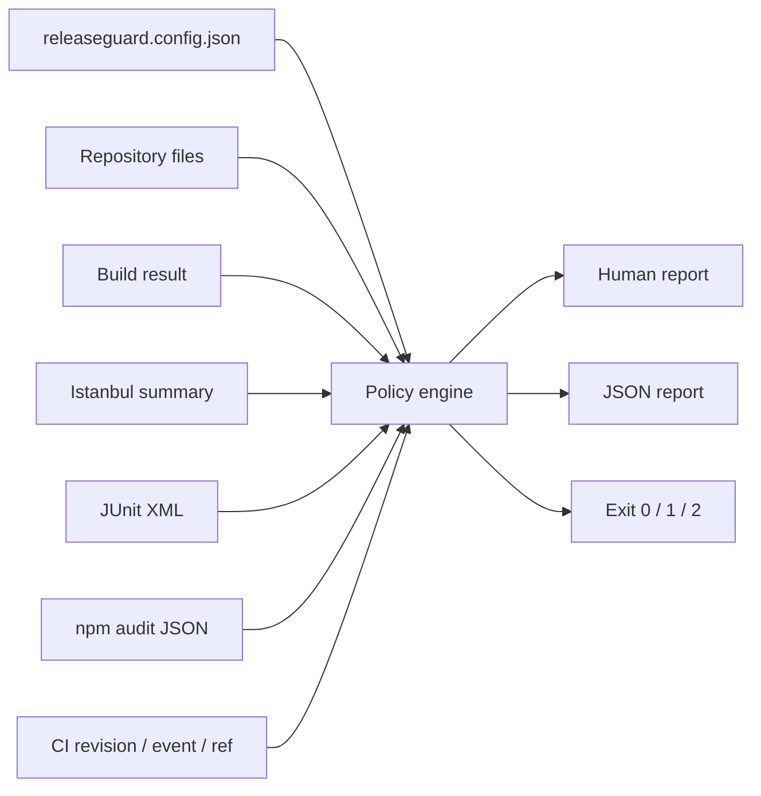

# ReleaseGuard Architecture

The core has no runtime package dependency. Parsers convert external artifacts
into small normalized models. Checks consume only those models and return an
ordered result containing status, message, and bounded evidence. Reporters do
not re-evaluate policy.

The CLI never executes build or test commands. CI creates artifacts first, then
ReleaseGuard evaluates them. This keeps command execution and policy
interpretation separate.
